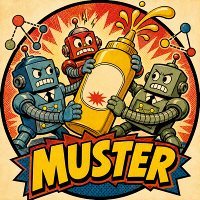

<p align="center">
  
</p>

<h1 align="center">muster</h1>

<p align="center"><em>A ledgered investigation runtime.</em></p>

muster runs investigations that are durable, coverage-gated, and resumable. You describe a
body of work as a graph of phases; muster drains that work off a SQLite ledger one item at
a time, records every step, and picks up exactly where it left off after a crash. Bounded,
adaptive model steps are supported, but they never decide when the work is done. The ledger
does.

## What it gives you

- **Run identity and layout.** Content-addressed project and run ids, one SQLite ledger per
  run, and a predictable on-disk directory (`muster.paths`).
- **The ledger.** A coverage-gated work queue with exactly-once durability, an audit trail,
  and resume (`muster.Ledger`).
- **Graph scaffolding.** Base `GraphState` and `GraphDeps`, a crash-safe `atomic_write`, a
  phase-entry helper, a durable-question channel, and a `WorkDispatcher` that maps work
  operations to handlers and drains the queue (`muster.graph`).

## How you use it

muster owns the machinery. You bring the domain: your own tables, your work handlers, and
what "covered" means for your problem. You register all of it by composition, so muster
never needs to know anything about your domain.

Subclass the ledger to add your tables:

```python
from muster import Ledger

class MyLedger(Ledger):
    def __init__(self, db_path):
        super().__init__(db_path,
                         extra_schema=MY_SCHEMA_SQL,
                         reset_tables=("facts", "findings"))
    # add your own record and count methods here
```

Register work operations as handlers and let the dispatcher drain them:

```python
from muster import WorkDispatcher

dispatcher = WorkDispatcher({"scan": handle_scan}, node_label="ProcessQueue")
```

The phase nodes stay in your own graph, since they are concrete-typed and reference your
own phases. muster provides the mechanism they run on.

## Durable questions

A phase that cannot decide something on its own records a question and keeps going, rather
than blocking. The run finishes in a `needs_input` state with the question pending; whoever
is driving it supplies an answer and resumes, and the answer survives the reset so the
re-run reads it and continues. Human-in-the-loop without giving up durability.

## Install

muster is consumed as a dependency. From another project:

```toml
# pyproject.toml
[project]
dependencies = ["muster"]

[tool.uv.sources]
muster = { git = "https://github.com/batteryshark/muster.git" }
```

The core depends only on `pydantic-graph`. An optional `model` extra adds `pydantic-ai`
for applications that build bounded model steps on top.

## Requirements

Python 3.11+.
